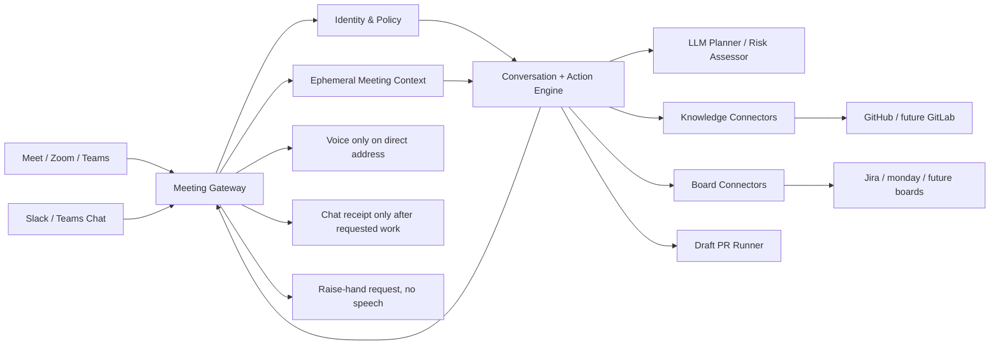
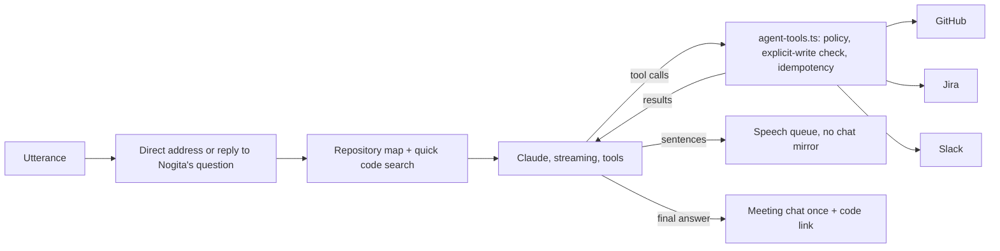

# Nogita — Provider-neutral architecture

## High-level diagram

## Implemented contracts (`src/core/contracts.ts`)

- `MeetingPort`: `join`, `speak`, `raiseHand`, `sendCompletion`, `leave`; capability flags.
- `BoardPort`: `createTask` returning provider-agnostic `ActionReceipt`.
- `CodePort`: `findEvidence`, with external source permalinks and snippets.
- `BrainPort`: `plan`, `answerWithEvidence`, `suggestContribution`.
- `PolicyPort`: distinct code-read / task-write / PR-write checks.

Connectors may use distinct user credentials, project IDs and board field schemas, without requiring changes to conversation orchestration. Keep board task schema generic, and introduce typed provider-specific options only in adapter configuration.

## Conversational agent (2026-10-28)

`NogitaEngine` hands every direct request to `runAgent` (`src/core/agent.ts`) when an `agent` model is configured:

- The toolbox is built per turn from the existing ports (`CodePort`, `BoardPort`, `ChatPort`) and `PolicyPort`;
  unauthorized speakers get no project tools. Writes run one at a time after parallel reads.
- If the model fails before saying or doing anything, the engine falls back to the one-shot planner path.
- Proactive participation: `BrainPort.assessContribution` runs in the background at most every 45 seconds and
  after four new utterances; it can only raise a hand. Its reason is given to the agent when Nogita gets the floor.

## Future multi-tool provider design

Add `Registry` with per-workspace provider connections, supported-capability discovery and credentials references (encrypted secrets manager). A task should be routed by configured project and provider, not by whichever brand happens to be named in casual speech.

A real meeting bot can use Recall to cover multiple meeting hosts initially. Do not create redundant Meet/Zoom/Teams API implementations unless a specific platform feature or cost structure requires it.

Identity resolution is independent from provider IDs: one human may have different IDs in Google Meet, Zoom, Slack, Jira, monday.com and GitHub. Explicitly map and verify, never infer by name alone.

## Runtime state & correctness

- Meeting context = bounded in-memory ring buffer (24 utterances in starter). Purge on session end.
- All tool writes require both model-intent AND deterministic explicit-user-request guards AND trusted caller authorization.
- Successful completion requires verified API response and a resulting URL.
- Demo event IDs are deduplicated in memory. Production must persist idempotency keys transactionally, and reconcile uncertain external writes before retrying.
- Audio I/O will need a separate real-time path; `POST /api/utterances` remains a local harness only.
- Use per-tenant authorization boundaries, token scoping, external source filtering and audit logs stripped of meeting content before production.

## Engineering decisions

1. Small TS/Node monolith first, instead of a distributed cluster.
2. Adapters behind interfaces; real provider API payloads never inside the engine.
3. Runtime is fail-closed for draft PR and for unsupported raise-hand functions.
4. Every spoken answer is also posted to meeting chat (Attendee cannot prove playback); a speech failure is
   recorded in usage metrics rather than hidden.
5. No background work that persists after meeting end in this starter. A future durable worker must be authorized and able to post completed receipts to the original meeting or an explicitly designated channel.
